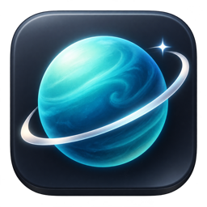
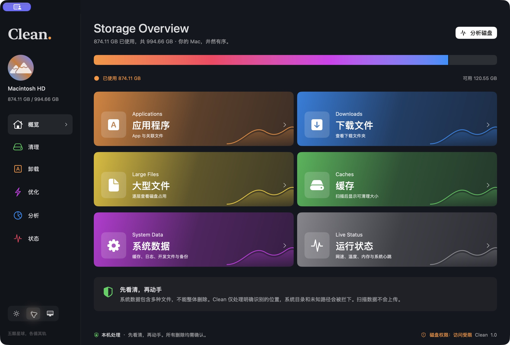

# Clean

[简体中文官网](https://bennix.github.io/Clean/) · [下载公证 DMG](https://github.com/bennix/Clean/releases/download/v1.0.1/Clean-1.0.1-AppleSilicon.dmg) · [发行说明](https://github.com/bennix/Clean/releases/tag/v1.0.1)

> **当前版本：1.0.1 · Apple Silicon · macOS 27+**  
> 应用与 DMG 均经 Developer ID 签名、Apple 公证并附加票据。

原生 SwiftUI macOS 磁盘工具。清理、关联卸载、维护、可视化分析和菜单栏监控，先看清，再动手。当前工程要求支持 macOS 27 SDK 的 Xcode。

## 运行

打开 `CleanMac.xcodeproj`，选择 `CleanMac` scheme 运行。构建产品、窗口和菜单名称为 **Clean**，内部 Swift module 保留 CleanMac。完整图标位于 Assets.xcassets/AppIcon.appiconset，设计源图位于 Design/Clean-Icon-Source.png。

## 当前实现

- 参考图的深色侧栏、彩色容量入口、波形装饰与真实磁盘总量；浅色 / 深色 / 跟随系统，自动保存选择。
- 本机用户缓存、用户日志、Xcode DerivedData / Archives / iOS DeviceSupport、模拟器缓存和 MobileSync 设备备份扫描，按是否含个人数据及大小排序。无默认勾选。
- 审查逐项路径、大小后，普通缓存永久删除；备份、归档与设备支持移入系统废纸篓。系统目录、未知路径、扫描根目录和符号链接拒绝删除。
- 分析、清理和应用扫描采用最多 4 个并发后台任务，先列出项目再分批更新大小；支持取消及切换页面。权限、缺失目录、跳过的链接有具体路径和原因，读取不完整的大小会标注。
- /Applications 和 ~/Applications 中只统计 .app，避免遍历无关目录。显示上次启动时间及距今；已运行或被 Clean 观察到的启动使用 launchDate，历史缺失时尝试 Spotlight 最近使用时间，明确标注来源，无记录则显示暂无记录。
- 卸载前逐项审查偏好、缓存、支持文件、应用容器、共享容器、网络数据、保存状态、日志与启动项；个人数据默认不勾选，已知其他应用仍使用的共享容器保留，系统启动服务和特权辅助工具提示使用厂商卸载器。
- 所选项目先校验关联边界再移入废纸篓，运行中应用拒绝卸载。用户 LaunchAgent 会先注销；可选移除成功卸载应用的 Dock 图标并刷新 Dock。
- 启动和返回应用时自动检测受保护位置的访问情况，在窗口底部显示实测状态；发现受限访问时每次运行自动提示一次，提供设置入口、当前应用位置及手动添加步骤。无公开 API 可直接查询或开启完全磁盘访问，不能将实测可读等同于全部系统路径可访问。
- 权限不足可选择通过 Finder 请求系统授权；仍需用户允许自动化 / 管理员验证。TCC 隐私授权与管理员权限分开处理，不保存密码。所有失败路径在可复制结果中列出。
- 目录逐层大小分析、按占用面积生成 treemap、Finder 显示；个人目录内符合边界的文件可确认移入废纸篓。
- DNS 刷新、Spotlight 重建、Time Machine 本地快照列表。写系统操作通过 macOS 授权，不保存密码。
- CPU / 内存 / 上下行网速实时采样和最近 60 秒图线，磁盘容量、GPU、电池、压缩内存、交换空间、系统负载及运行时间。网速仅合计活动物理 en 网卡，避免与 VPN / 桥接接口重复统计。
- Apple Silicon IOHID 温度传感器读取，兼容旧 IOHWSensor；显示最高实测温度，可展开查看全部传感器。重复传感器按名称合并，非法读数过滤；非公开温度接口动态加载，系统不支持时明确显示读取失败，不使用热状态推算摄氏温度。
- 点击“状态”或“运行状态”收起主窗口并展示菜单栏面板；最小化和关闭主窗口后继续驻留菜单栏，面板支持打开主窗口和彻底退出。

## 限制与尚未完成

- 这是可运行的首版，尚未覆盖参考软件完整的 11 类缓存、22 项维护任务、进程监控、排序及置顶。
- 尚未实现快照精简 / 删除，不自动修改备份。温度和 GPU 的可用性依机型与 macOS 版本而定。
- 系统数据不是单一目录，也不代表全部可删除。容量条显示磁盘已用与可用总量，不伪造分类容量。APFS 共享块和本地快照会导致扫描大小与最终回收空间不同。
- 无法访问、缺失的根路径会计入跳过数；受限子目录可能使大小低估。macOS 隐私控制仍然生效，可能需要用户在系统设置授予磁盘访问权限。
- 为实现独立 macOS 清理工具的文件操作，当前关闭 App Sandbox；这不会自动获得完全磁盘访问权限。源码自行构建的版本需要使用自己的签名；仓库 Release 提供已签名和公证的发行版。
- 无任何联网逻辑；未配置许可证或更新服务。

## 验证

`xcodebuild -project CleanMac.xcodeproj -scheme CleanMac -configuration Debug CODE_SIGNING_ALLOWED=NO -only-testing:CleanMacTests test`

19 项测试覆盖路径边界、符号链接逃逸、分析页废纸篓边界、只读扫描、并发统计一致性、取消、应用过滤、读取错误分类、未知卸载目标、Dock 精确匹配及监控数据处理。开发验证不对用户真实缓存执行删除，也不执行管理员维护。

## 安装与权限

下载 Release 中的 DMG，打开后将 Clean 拖入“应用程序”。需要更完整扫描时，在“系统设置 → 隐私与安全性 → 完全磁盘访问权限”添加 `/Applications/Clean.app`，按系统提示重新启动应用。

1.0.1 修复已授权后仍保留添加权限引导的问题：检测恢复后自动关闭自动引导，手动查看时显示访问已就绪。扫描中个别 ACL / SIP / 应用数据保护导致的失败与磁盘访问探测分开，不会直接被判定为完全磁盘访问未开启。

## 官网

`docs/` 是无构建依赖的简体中文静态网站，含深浅色实机图、菜单栏监控图、交互预览、安装说明与功能边界。推送 `main` 后通过 GitHub Actions 发布到 GitHub Pages。

本地预览：`python3 -m http.server 8766 --directory docs`。

## 构建与签名

在 Xcode 中选择自己的签名团队后运行。测试可使用 `CODE_SIGNING_ALLOWED=NO`；发行应使用 Developer ID Application 证书并启用 Hardened Runtime。Apple ID 密码、证书私钥及公证凭据均不包含在仓库中。发行二进制和公证记录通过 GitHub Release 提供，不提交到 Git 历史。
